# php-virt-manager

[](https://github.com/spidero/php-virt-manager/actions/workflows/ci.yml)
[](https://github.com/spidero/php-virt-manager/pkgs/container/php-virt-manager)

Web panel for libvirt/KVM written in PHP (Smarty 5, Bootstrap 5).

Manage virtual machines from the browser: a dashboard with live charts,
graphical and text consoles, machines from cloud images with cloud-init or
from ISO (BIOS/UEFI, Secure Boot, TPM), live device changes, snapshots with
schedules, networks and storage pools, host device passthrough, users with
roles and a REST API - deployable with one script on nginx or as a Docker
container (`ghcr.io/spidero/php-virt-manager`). Interface in English, German,
Norwegian, Polish, Spanish and Ukrainian.

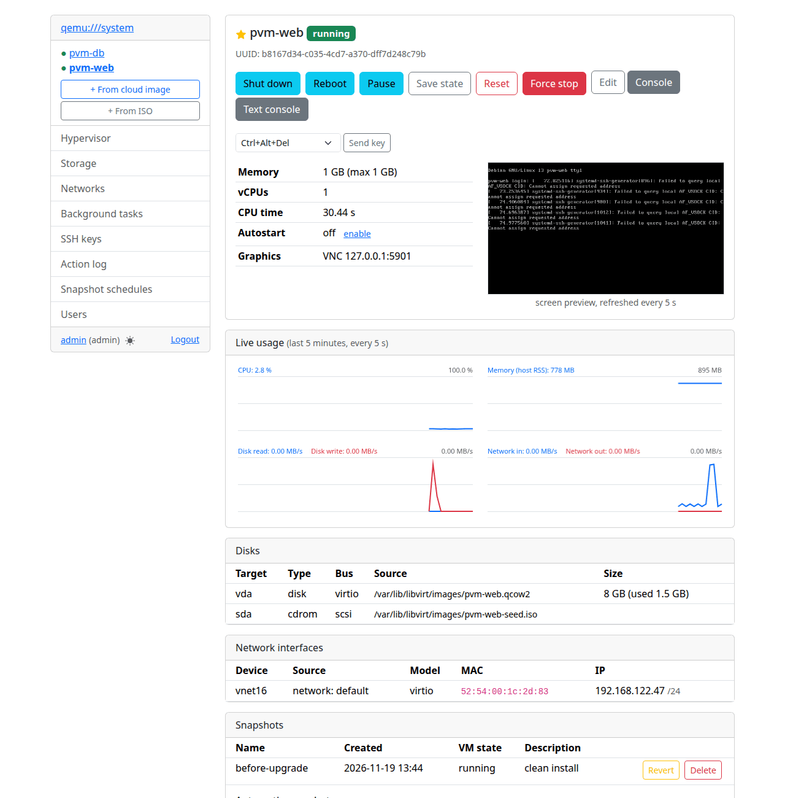

## Quick start with Docker

The panel ships as a ready image:
[`ghcr.io/spidero/php-virt-manager`](https://github.com/spidero/php-virt-manager/pkgs/container/php-virt-manager)
(linux/amd64, nginx + php-fpm + websockify/noVNC in one container). It runs on
the KVM host itself and manages that host's libvirt.

**Host requirements:** Linux with KVM and libvirt running (`libvirtd` or
`virtqemud`, socket in `/var/run/libvirt`), Docker with the Compose plugin.
Optional, on the host: `ovmf` for UEFI machines, `swtpm` for the emulated TPM,
the NFS client (`nfs-common`) for NFS storage pools, `open-iscsi` for iSCSI
pools, the libvirt ZFS/RBD storage drivers for those pools, `virtiofsd` for
shared folders, IOMMU (VT-d/AMD-Vi) for PCI passthrough.

**Access to libvirt (required, once):** the panel runs as uid 33 (`www-data`)
and libvirt checks access with polkit, which allows members of the `libvirt`
group - by the groups of that uid on the **host**. Add it on the host:

```sh
sudo usermod -aG libvirt $(id -nu 33)    # usually www-data
```

Without it the panel shows `authentication unavailable: no polkit agent
available` (see [Troubleshooting](#troubleshooting)).

### 1. Start

With `docker run`:

```sh
docker run -d --name php-virt-manager \
  --network host \
  --restart unless-stopped \
  -e TZ=Europe/Warsaw \
  -e HTTPS_PORT=9443 \
  -e HTTP_PORT=9080 \
  -e WS_PORT=6081 \
  -e PVM_USER=admin \
  -e PVM_PASSWORD=change-me \
  -v /var/run/libvirt:/var/run/libvirt \
  -v pvm-data:/app/data \
  -v pvm-ssl:/etc/nginx/ssl \
  ghcr.io/spidero/php-virt-manager:latest
```

or with Compose, using [`docker-compose.yml`](docker-compose.yml) from this
repository (edit the `environment:` section first):

```sh
curl -O https://raw.githubusercontent.com/spidero/php-virt-manager/master/docker-compose.yml
docker compose up -d
```

### 2. Log in

Open `https://<host>:9443/` (self-signed certificate - accept the browser
warning, or mount your own, see below) and log in as `PVM_USER` /
`PVM_PASSWORD`. Without `PVM_PASSWORD` a random password is generated and
printed once in the log:

```sh
docker logs php-virt-manager 2>&1 | grep login    # Compose: docker compose logs | grep login
```

The first administrator is created on the first start and stored in the
`pvm-data` volume; change the password and add further users in the panel.
When `PVM_PASSWORD` (or `PVM_PASSWORD_HASH`) is set, it is applied to the
`PVM_USER` account on every start, overwriting a password changed in the panel -
handy to recover access; remove the variable to manage the password in the panel.
Without it a password stored in the volume stays, and a random one printed in
the log applies only to a fresh volume.

### Ports

The container uses **host networking** (`--network host`), so there is no
`-p` mapping: VNC consoles of the machines listen on the host's `127.0.0.1`
and the container must reach them. The ports are set with environment
variables and opened directly on the host:

| Variable     | Default | Listens on        | Purpose                               |
|--------------|---------|-------------------|---------------------------------------|
| `HTTPS_PORT` | `9443`  | all interfaces    | the panel (open it in the firewall)   |
| `HTTP_PORT`  | `9080`  | all interfaces    | redirects to HTTPS                    |
| `WS_PORT`    | `6081`  | `127.0.0.1` only  | websockify for the consoles (nginx proxies it, do not expose) |
| -            | `7100-7999` | `127.0.0.1` only | text consoles of the machines (one port per machine, opened by QEMU) |

Choose ports that are free on the host (`ss -tlnp`).

### Configuration

| Variable            | Default          | Description                              |
|---------------------|------------------|------------------------------------------|
| `LIBVIRT_URI`       | `qemu:///system` | libvirt connection                       |
| `PVM_USER`          | `admin`          | first administrator (created on first start) |
| `PVM_PASSWORD`      | random           | its password (or `PVM_PASSWORD_HASH`, a `password_hash()` bcrypt hash); applied on every start when set |
| `PVM_READONLY`      | `0`              | `1` = view only                          |
| `PVM_CLOUD_CATALOG_URL` | GitHub list  | cloud image catalog to synchronize from (see [Cloud image catalog](#cloud-image-catalog)) |
| `PVM_CLOUD_CATALOG_SYNC` | `1`         | `0` = no automatic daily synchronization |
| `PVM_UPDATE_CHECK`  | `1`              | `0` = no daily check for a newer release (see [Updates](#update)) |
| `TZ`                | `UTC`            | time zone (logs, snapshot schedules)     |
| `HTTPS_PORT`, `HTTP_PORT`, `WS_PORT` | see [Ports](#ports) | |

| Volume                    | Contents                                               |
|---------------------------|--------------------------------------------------------|
| `/var/run/libvirt` (bind) | host libvirt socket; the container joins its group automatically |
| `/app/data`               | user database, action log, login lock data, console tokens |
| `/etc/nginx/ssl`          | `cert.pem`, `key.pem` - a self-signed pair is generated if missing |

Your own certificate: put `cert.pem` (full chain) and `key.pem` into a host
directory and mount it instead of the volume, e.g.
`-v /etc/php-virt-manager/ssl:/etc/nginx/ssl:ro`.

### Update

```sh
docker pull ghcr.io/spidero/php-virt-manager:latest
docker rm -f php-virt-manager && docker run ...       # same command as above
# Compose: docker compose pull && docker compose up -d
```

Users, logs and the certificate stay in the volumes.

The panel checks once a day whether a newer release exists - it reads
[`version.json`](version.json) from GitHub (only the IP address of the server
is visible to GitHub) - and shows it to administrators in the footer and on
the dashboard; *check for updates* in the footer checks at once.
`$update_check = false` (`PVM_UPDATE_CHECK=0`) turns it off. A release tag
must match `version.json`, CI refuses it otherwise.

### Versions

| Tag      | Built from                                           |
|----------|------------------------------------------------------|
| `latest` | every push to `master` and every release tag         |
| `2.0.0`  | release tag `v2.0.0` (pin it to stay on a version)   |

Images are published by CI after the tests pass. A release is made by pushing
a tag (`git tag v2.0.1 && git push origin v2.0.1`); an existing tag can be
rebuilt from Actions → CI → Run workflow. To build the image from source:
`docker compose up -d --build`.

### Troubleshooting

The first lines of `docker logs php-virt-manager` show the version (release,
`master` or `dev` for a local build), the commit and the PHP version - include
them in bug reports.

- `WARNING: /var/run/libvirt/libvirt-sock not found` - libvirt is not running
  on the host or the socket is not mounted (`-v /var/run/libvirt:/var/run/libvirt`).
- `Cannot connect to qemu:///system: authentication unavailable: no polkit agent
  available` - libvirt on the host checks access with polkit, which allows
  members of the `libvirt` group. The panel runs as uid 33 (`www-data` in
  the container), and polkit checks the host's groups of that uid, so add it on
  the host: `sudo usermod -aG libvirt $(id -nu 33)` (usually `www-data`).
- the panel does not open - check `docker logs php-virt-manager`, whether the
  port is free and allowed in the firewall.
- the console does not connect - the machine needs a VNC graphics device; the
  container must run with `--network host`.
- the text console stays empty - press Enter for a login prompt; only one
  client can be connected at a time; the guest needs a console on `ttyS0`.
- a machine from a Debian 12 cloud image comes up as `localhost` without a
  network - it was created before the cloud-init CD-ROM moved to virtio-scsi
  (the Debian 12 cloud kernel has no SATA driver); create it again.
- a snapshot of a running UEFI machine fails - libvirt supports internal
  snapshots of UEFI machines only when they are shut off.

## Features

**Overview**

- dashboard: machine table with state, guest IPs and live CPU, memory and
  disk use; live charts of host CPU and memory; host details (CPU model,
  memory)
- starred machines in the menu, a machine page with live charts (CPU,
  memory, disk and network throughput), disks, interfaces and screen preview
- light/dark theme (system preference or the icon in the menu), interface in
  English, German, Norwegian (bokmål), Polish, Spanish and Ukrainian

**Machines**

- power actions: start, shutdown, reboot, pause/resume, force stop, hard
  reset, save state to disk (restored by the next start)
- editing: maximum and current memory (balloon, changed live), CPU topology
  (sockets, cores, threads) and model, current vCPUs (hot-plug) and pinning to
  host CPUs (both live), CD/DVD medium, boot order, rename
- disks: add a new one or attach an existing volume (virtio, SCSI or SATA bus,
  cache mode), grow (also while running), detach (optionally deleting the
  file), I/O limits (MB/s, IOPS); network interfaces also get bandwidth limits
  - limits change live; network interfaces: add, switch network (live) or model, detach -
  devices are hot-plugged into running machines
- network interfaces connect to a libvirt network, a host bridge (machine in
  the LAN) or directly to a host interface (macvtap) - in both wizards and
  on the edit page; host bridges and interfaces are listed for local
  connections
- firmware (BIOS, UEFI, UEFI with Secure Boot) and the emulated TPM of an
  existing machine (shut off)
- title and description of a machine (shown in the machine table and on its
  page, also in the API)
- hardware: video model, sound, watchdog, virtio-rng, VNC password (passed to
  the browser console automatically), shared host folders (virtiofs, for
  administrators)
- XML definition editor for administrators (checked against the libvirt
  schema)
- host device passthrough for administrators: USB (by vendor and product,
  also live) and PCI devices (next start, needs IOMMU)
- migration to another hypervisor for administrators (live for a running
  machine, optionally copying the disks; the definition for a shut off one)
  as a background job with progress
- cloning in the background with a choice per disk (copy, share the same
  file, leave out) and deleting machines with a choice of disks; disks used
  by other machines are protected
- snapshots: create, revert, delete; automatic snapshots hourly, daily or
  weekly with retention (keep the newest N)

**Consoles**

- graphical console (noVNC) with key combinations (Ctrl+Alt+Del,
  Ctrl+Alt+F1...), full screen and "type text" (sends text as key presses,
  e.g. a password - a shared clipboard needs an agent in the guest), SPICE to
  VNC switch
- text (serial) console in the browser (xterm.js)

**New machines**

- from cloud images with cloud-init: Ubuntu, Debian, AlmaLinux, Rocky Linux
  out of the box, an editable catalog synchronized from GitHub; user with SSH
  keys (saved keys selectable) and/or password, hostname, disk size - ready
  to log in within a minute
- from ISO (any pool; ISO images can be downloaded from a URL in the
  background), by importing an existing disk, or by network boot (PXE);
  BIOS or UEFI with optional Secure Boot, emulated TPM 2.0; operating system
  profiles fill in recommended values - Windows 10/11/Server get Hyper-V
  enlightenments, a local time clock and either the virtio-win drivers ISO as
  a second CD-ROM (virtio disk and NIC) or a SATA disk and e1000e NIC

**Storage and networks**

- storage pools: create (directory, NFS share, existing LVM volume group,
  iSCSI target, whole disk, ZFS pool, Ceph RBD - only the types the
  hypervisor supports are offered), remove (files are kept), start/stop, autostart, refresh; volumes: create,
  grow, copy (in the background), delete - volumes in use are protected
- networks: create (NAT, routed, isolated) and delete, start/stop, autostart,
  DHCP range and static IP addresses per MAC (changed live), DHCP leases

**Administration**

- users with roles (admin, operator, viewer), personal SSH keys, login
  lockout, CSRF protection, read-only connections
- several hypervisors (local or `qemu+ssh://`) switchable in the menu; added,
  tested and removed by administrators on the *Connections* page (or fixed in
  `config.php`)
- REST API with per-user tokens (same permissions as the user's role)
- background task queue with progress bars, action log with rotation

## Screenshots

| | |
|---|---|
| 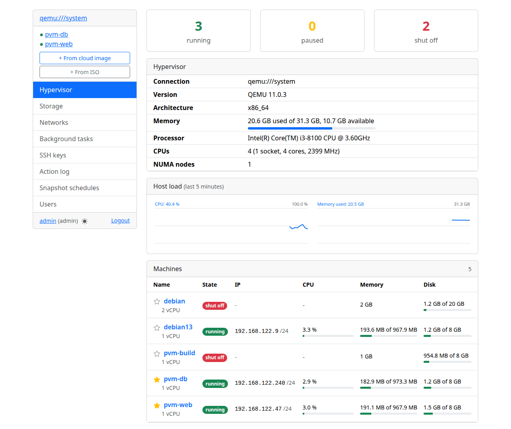 | 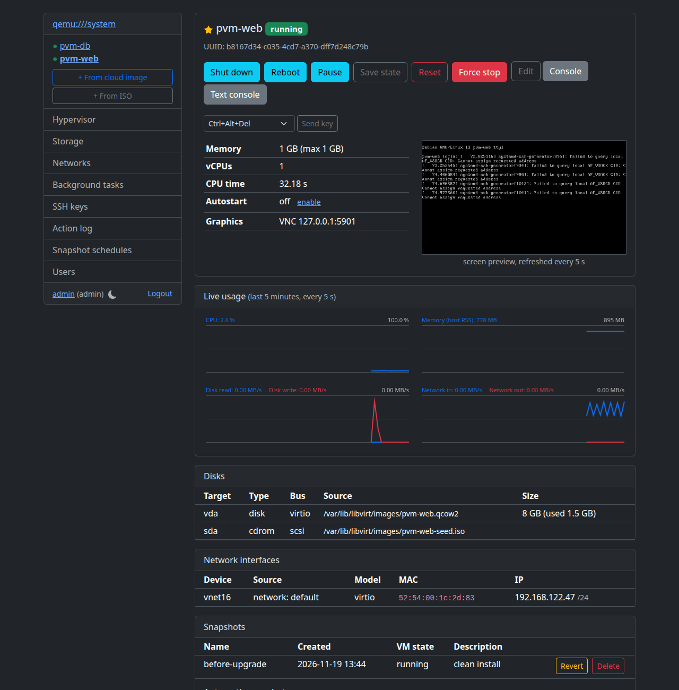 |
| **Dashboard** - machine table with live CPU, memory and disk use, host charts, starred machines in the menu | **Machine page** in the dark theme - actions, live charts, disks, snapshots |
| 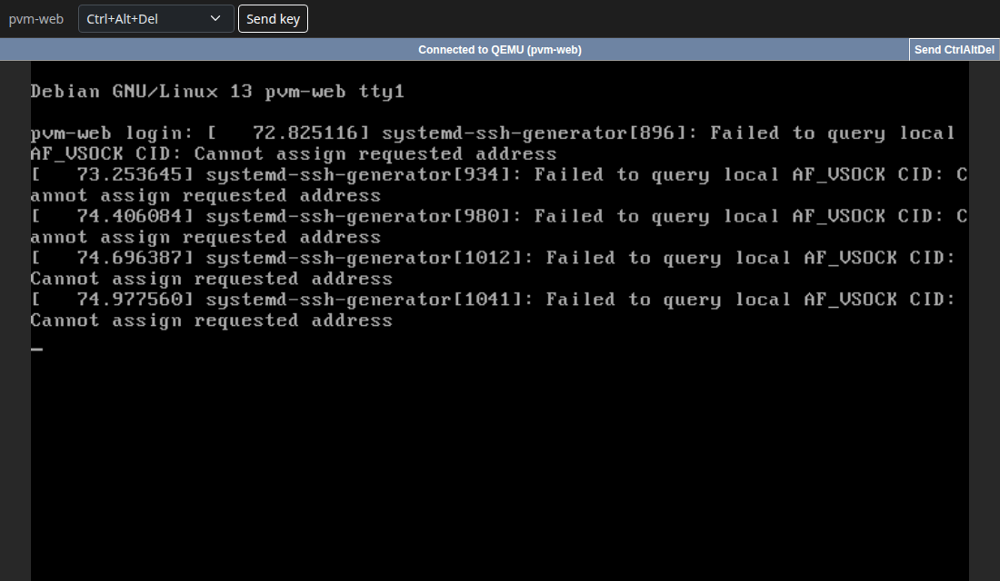 | 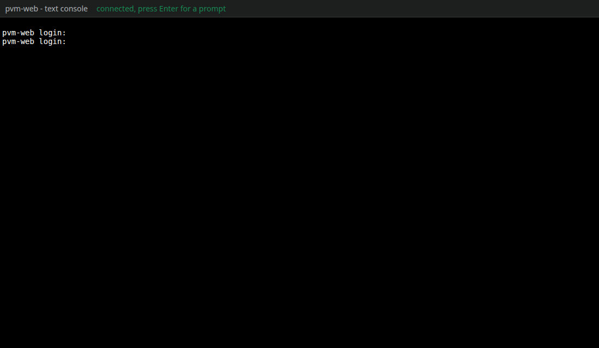 |
| **Console** - noVNC with key combinations | **Text console** - the serial port in the browser |
| 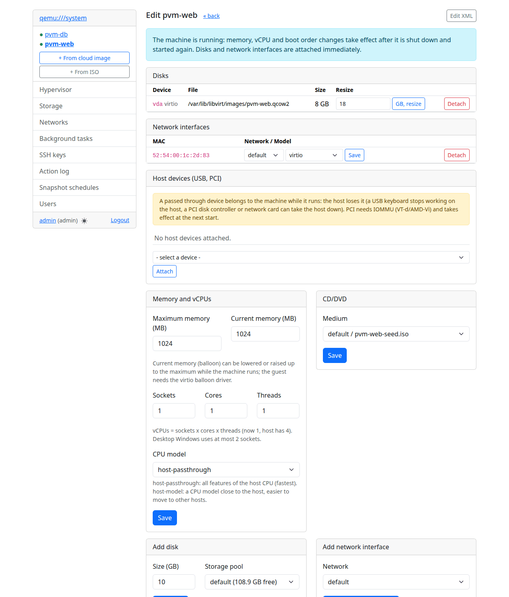 | 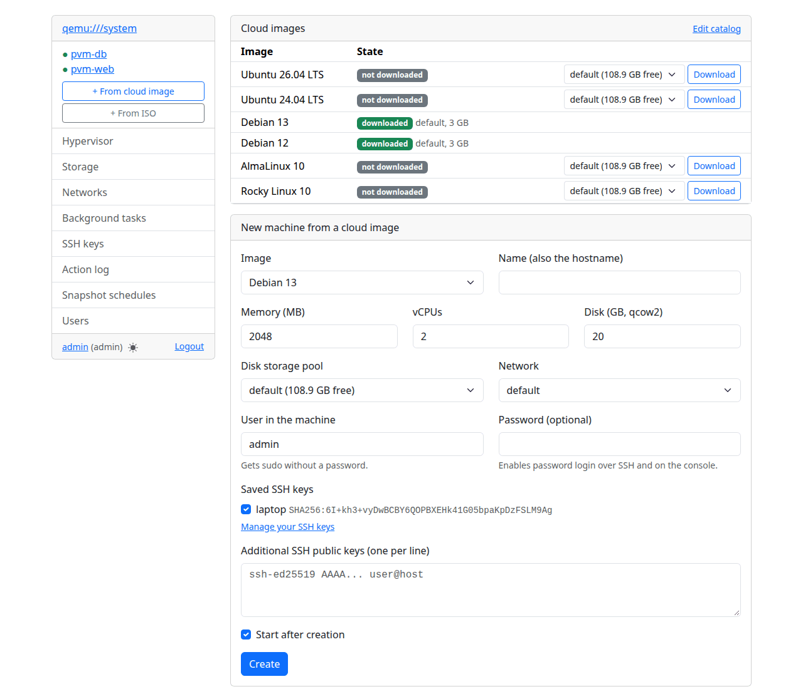 |
| **Editing** - disks, interfaces, host devices, memory and CPU topology | **Cloud images** - a new machine with cloud-init in a minute |
| 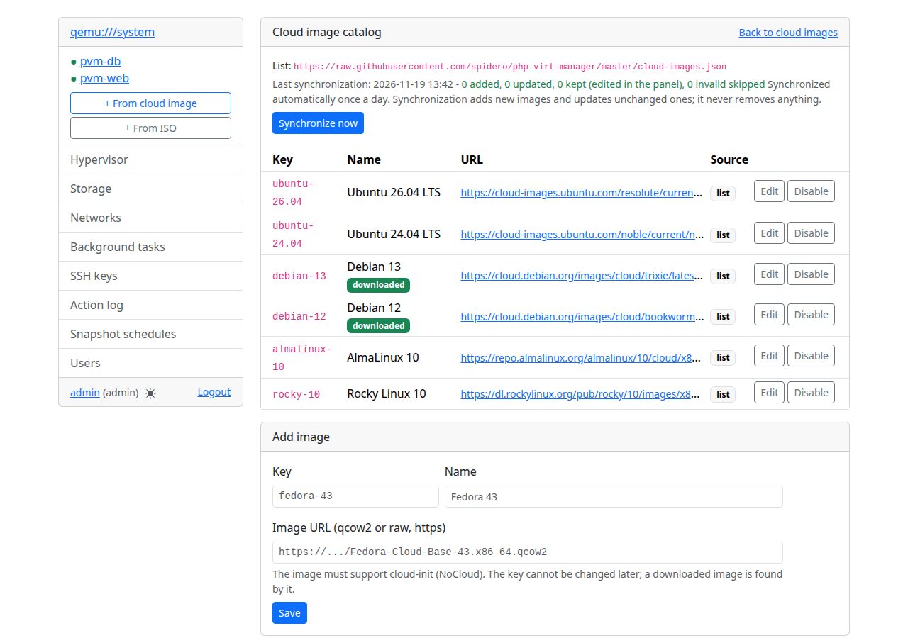 | 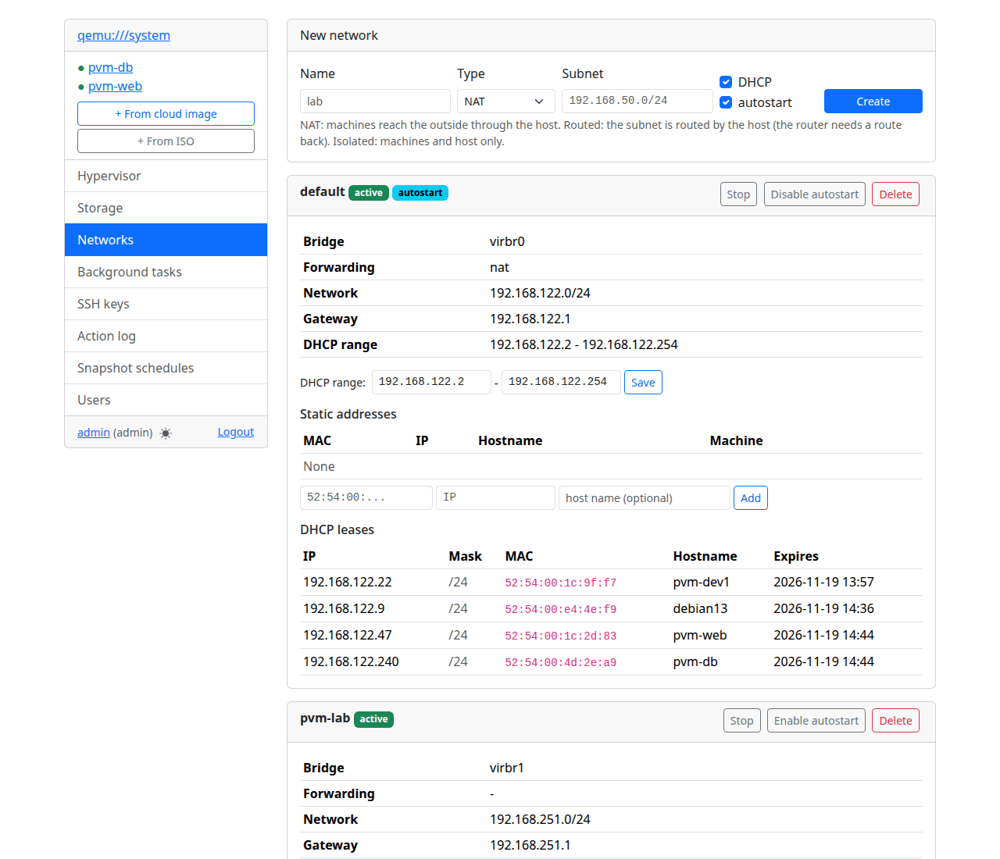 |
| **Catalog** of cloud images, synchronized from GitHub | **Networks** - new networks, DHCP range, static addresses |
| 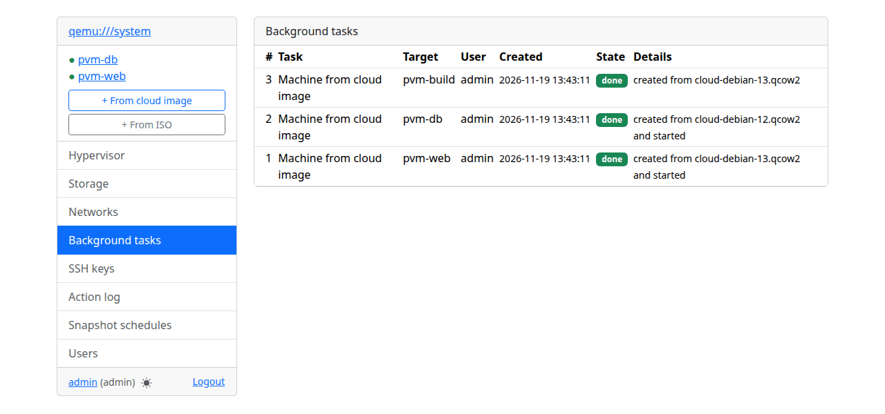 | 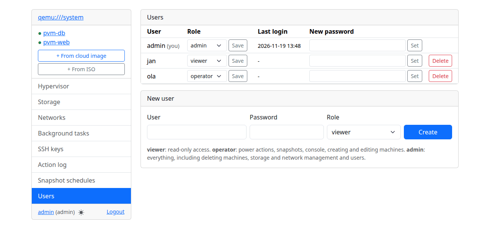 |
| **Background tasks** with progress | **Users** with admin, operator and viewer roles |
| 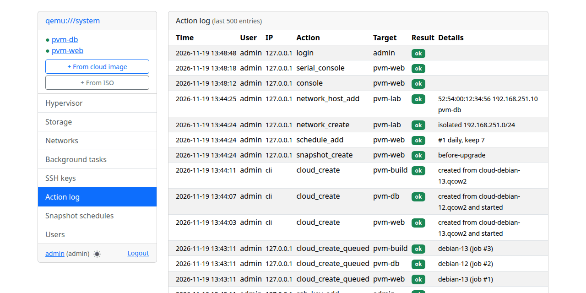 | |
| **Action log** - who did what and when | |

## Requirements (without Docker)

- PHP >= 8.4 with the libvirt and SQLite extensions (Debian/Ubuntu:
  `php-libvirt-php`, `php-sqlite3`)
- composer
- access to the libvirt socket (the PHP user must be in the `libvirt` group)
- for the browser console: nginx, websockify and noVNC (see Deployment)
- for cloud images: `xorriso` (or `genisoimage`), `virsh` (`libvirt-clients`)
  and the PHP curl extension; `virsh` is also used for renaming, network
  updates and saved states, `virt-xml-validate` (`libvirt-clients`) by the XML
  editor
- on the KVM host, for the matching features: `ovmf` (UEFI), `swtpm` (TPM),
  `nfs-common` (NFS pools), IOMMU enabled (PCI passthrough)

## Development setup

The built-in server runs as your user, which must be in the `libvirt` group
(`sudo usermod -aG libvirt $USER`, then log in again) to manage
`qemu:///system`.

```sh
composer install
mkdir -p templates_c configs cache
cp config-default.php config.php
php -r 'echo password_hash("your-password", PASSWORD_DEFAULT), PHP_EOL;'
# paste the hash into $auth_password_hash in config.php - this account becomes
# the first administrator, further users are managed in the panel
# (lost the password later? put a new hash there and run: php bin/set-password.php)
php -d extension=libvirt-php -S 127.0.0.1:8099
# background jobs (image downloads, clones), snapshot schedules and cleanup;
# on a server this runs every minute from systemd/Docker, here keep it running:
php -d extension=libvirt-php bin/cron.php --loop
```

The built-in server is for development only; the browser console is not
available there.

### Enabling the libvirt extension

On Ubuntu the module and its ini file are in separate packages:

```sh
sudo apt install php-libvirt-php php8.5-libvirt-php    # use your PHP version
sudo phpenmod libvirt-php
```

If `php-libvirt-php` is not available, enable the module manually:

```sh
echo "extension=libvirt-php.so" | sudo tee /etc/php/8.5/mods-available/libvirt.ini
sudo phpenmod libvirt
```

## Deployment

### nginx on the host

```sh
sudo deploy/install.sh
```

The nginx configuration also routes `api.php/v1/...` (PATH_INFO) and passes the
`Authorization` header. The script installs nginx, php-fpm, websockify and noVNC, copies the panel to
`/var/www/php-virt-manager`, creates `config.php` with a random password
(printed at the end), a self-signed TLS certificate, a dedicated php-fpm pool
running with the `libvirt` group (and adds `www-data` to that group, which
polkit requires), a systemd unit for websockify and a systemd
timer running `bin/cron.php` every minute (background jobs, snapshot schedules,
log rotation).

Defaults: HTTPS on port 8443 (HTTP 8090 redirects), websockify on
127.0.0.1:6080. Override with environment variables `APP_DIR`, `HTTPS_PORT`,
`HTTP_PORT`, `WS_PORT`, `PHP_VERSION`. Re-running the script updates the
application and keeps `config.php`, the certificate and `data/`.

### Docker

See [Quick start with Docker](#quick-start-with-docker) above.

### Apache

`.htaccess` blocks internal files and directories (requires
`AllowOverride All`). The browser console needs a websocket proxy and is
supported only with the nginx configuration from `deploy/`.

## Configuration

See `config-default.php`: time zone (default: the system zone), libvirt
connections (`$connections`, each can be read-only), first administrator,
login lockout (`$login_max_attempts`, `$login_lock_seconds`), data directory,
action log rotation, console settings and the cloud image catalog
(`$cloud_catalog_url`, `$cloud_catalog_auto_sync`, `$cloud_images`).

### Remote hypervisors

Administrators add connections such as `qemu+ssh://root@kvm2.example.com/system`
on the *Connections* page (*Test* checks them with `virsh`). SSH connections
use the key of the panel user: `www-data` on a host install, inside the
container for Docker (mount a key, e.g. `-v /srv/pvm-ssh:/var/www/.ssh:ro`
with `id_ed25519` and `known_hosts`); `?no_verify=1` in the URI skips the host
key check. Consoles work only for local connections.

### Users and roles

| Role       | Permissions |
|------------|-------------|
| `viewer`   | read-only access, starring machines |
| `operator` | power actions, snapshots, consoles, creating and editing machines (resources, disks, interfaces), saved SSH keys |
| `admin`    | everything, including deleting machines, the XML editor, host device passthrough, storage pools and networks, the cloud image catalog, users and the action log |

## Cloud images

Base images are downloaded by an administrator (Cloud images page) into a
storage pool as `cloud-<name>.qcow2`. A new machine gets a full copy of the
image grown to the requested size and a small `<name>-seed.iso` with the
cloud-init configuration (NoCloud); the ISO is deleted together with the
machine.

### Cloud image catalog

The list of images lives in [`cloud-images.json`](cloud-images.json):

```json
{"version": 1, "images": [
  {"key": "debian-13", "label": "Debian 13", "url": "https://cloud.debian.org/.../debian-13-genericcloud-amd64.qcow2"}
]}
```

The panel starts with the copy shipped with it and synchronizes from
`$cloud_catalog_url` (default: the same file on GitHub,
`https://raw.githubusercontent.com/spidero/php-virt-manager/master/cloud-images.json`)
with the *Synchronize now* button and once a day from `bin/cron.php`
(`$cloud_catalog_auto_sync = false` turns that off). Point the URL to your
own file (a fork, a gist, an internal server - `https://` only) to manage
the list centrally.

Administrators edit the catalog on *Cloud images → Edit catalog*: add own
images, change the name or URL, disable entries. Synchronization only adds
new images and updates entries that were not edited in the panel - nothing
is removed; entries from the list can be disabled, own entries also deleted.
A disabled image that is already downloaded stays usable in the wizard.
Fixed entries can still be added in `config.php` (`$cloud_images`, same
format as before).

Files are copied into pools with `virsh vol-upload`, because the web server
cannot write to pool directories and `libvirt_stream_send()` of libvirt-php
0.5.x sends corrupted data.

## REST API

JSON API with personal tokens (created in the profile, same permissions as
the user's role): machines, power actions (including reset and saving the
state), snapshots, cloning and machines from cloud images as background
jobs, saved SSH keys, networks and pools.

```sh
curl -H "Authorization: Bearer pvm_..." https://panel.example.com:8443/api.php/v1/domains
```

- Guide with examples (curl, shell, Python, Ansible): [doc/api.md](doc/api.md)
- OpenAPI 3.1 specification: [doc/openapi.yaml](doc/openapi.yaml)

## Console

The console works for machines with VNC graphics. Machines using SPICE show a
"switch to VNC" action which rewrites the persistent definition (SPICE agent
channel and USB redirection are removed); the change takes effect after the
machine is shut down and started again. Each console opening creates a
one-hour token; the websocket proxy additionally requires a logged in session.

A toolbar above the console (and the machine page) sends key combinations
such as Ctrl+Alt+Del or Ctrl+Alt+F2 without disconnecting.

The **text console** is a serial terminal in the browser
([xterm.js](https://xtermjs.org/), MIT, bundled in `assets/vendor/xterm`):
the machine's serial port listens on `127.0.0.1:7100-7999` (one port per
machine, assigned by the panel) and websockify forwards it with the same
tokens. Machines created from cloud images have it; for others enable it on
the edit page (after a restart). Notes: only one client can be connected at
a time, `virsh console` does not work for such a machine (it needs a pty
serial port), and local users of the host can reach the port, like the VNC
port of a machine.

## Development

```sh
composer install
vendor/bin/phpstan analyse
vendor/bin/phpunit
php bin/i18n-strings.php de     # untranslated strings of a language
```

Translations live in `lang/<code>.php` (English source strings as keys); a new
language is added to `LANGUAGES` in `lib/i18n.php`. Tests check that every
language is complete and keeps the `%s`/`%d` placeholders.

`composer install` also copies the Bootstrap CSS to `assets/css/` (the
`vendor/` directory is not served).

`stubs/libvirt.stub.php` declares the libvirt extension API for static
analysis. CI (GitHub Actions) runs lint, PHPStan, PHPUnit, a translation check and a
Docker image build; once they pass, pushes to `master` and `v*` tags publish
the image to `ghcr.io`.

## Security notes

- The panel controls machines on `qemu:///system`; use HTTPS and a strong
  password, do not expose it to untrusted networks.
- VNC and the text consoles listen on 127.0.0.1 only; remote access goes
  through the authenticated websocket proxy. Local users of the host can reach
  these ports.
- The XML editor and host device passthrough are limited to administrators:
  both can give a machine access to host resources.
- Report vulnerabilities privately, see [SECURITY.md](.github/SECURITY.md).

## Contributing and contact

Ideas, bug reports and questions are welcome on GitHub - the panel shows the
same links in a box on the dashboard:

- [suggest a feature](https://github.com/spidero/php-virt-manager/issues/new?template=feature_request.yml)
- [report a bug](https://github.com/spidero/php-virt-manager/issues/new?template=bug_report.yml)
- [report a security issue privately](https://github.com/spidero/php-virt-manager/security/advisories/new)
- pull requests: see [CONTRIBUTING.md](.github/CONTRIBUTING.md)

## License

php-virt-manager is free software: you can redistribute it and/or modify it
under the terms of the GNU General Public License as published by the Free
Software Foundation, either version 3 of the License, or (at your option) any
later version. See [LICENSE](LICENSE).
